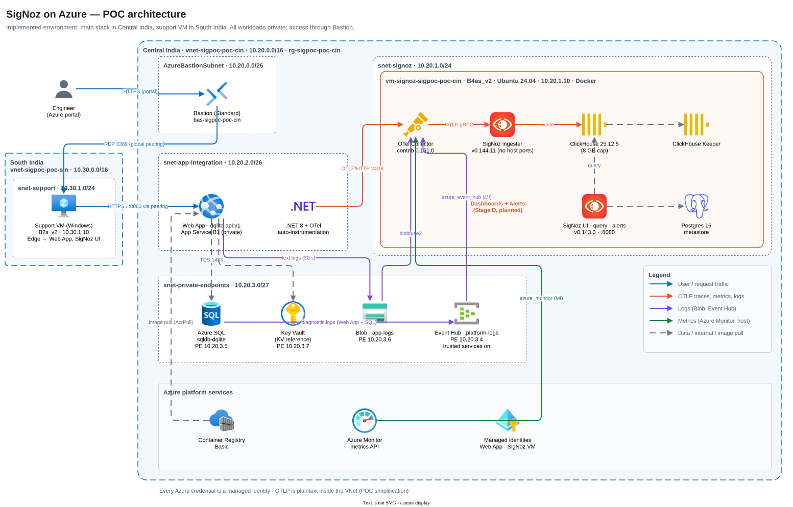

# SigNoz on Azure — observability POC

A self-hosted [SigNoz](https://signoz.io) stack on Azure, fed by OpenTelemetry from a .NET 8 web app running as a
container on private App Service, plus Azure platform logs (diagnostic settings → Event Hub) and platform metrics
(Azure Monitor API). Everything is private (private endpoints, no public IPs on workloads), deployed with Terraform,
and every Azure credential is a managed identity.

See [docs/signoz-poc-report.md](docs/signoz-poc-report.md) for the full write-up.

```text
App Service (.NET 8 + OTel auto-instrumentation, no code change)
   ├─ OTLP ───────────────────────────────┐
   ├─ text logs → Blob → blobfuse2 ───────┤
Diagnostic settings → Event Hub ──────────┼─► OTel Collector (contrib 0.161) ─► SigNoz (Foundry) ─► ClickHouse
Azure Monitor metrics API ────────────────┤        on the SigNoz VM
VM host metrics ──────────────────────────┘
Access: Bastion → Windows support VM (peered VNet) → browser to the app and the SigNoz UI
```

## Repository layout

| Path | Contents |
| --- | --- |
| `deploy/terraform/azure/infra/` | Terraform, one file per component; per-deployment settings in `environments/*.tfvars` |
| `app/` | DQ Lite demo app (ASP.NET Core 8, EF Core, Azure SQL), Dockerfile with OpenTelemetry auto-instrumentation, `deploy.sh` |
| `collector/` | OpenTelemetry Collector config, Docker Compose, `install.sh` (blobfuse2 mount + start) |
| `signoz/` | `casting.yaml` for SigNoz's Foundry installer (pinned versions, patches) |
| `docs/signoz-poc-report.md` | Full write-up: architecture, Azure resources, Terraform, app, OpenTelemetry, SigNoz, tests, 20 issues with fixes, timeline, security, cost, production gaps |
| `docs/diagrams/*.drawio.svg` | Architecture and telemetry-pipeline diagrams (editable draw.io files that render as images) |



The diagrams are `.drawio.svg` files: open them in draw.io desktop, the VS Code *Draw.io Integration* extension or app.diagrams.net, edit and save. GitHub and the Markdown docs show the updated image automatically.

## Deploy

Prerequisites: Azure subscription, Terraform ≥ 1.9, Azure CLI, Docker.

1. **Infrastructure**
   ```bash
   cd deploy/terraform/azure/infra
   cp environments/example.tfvars environments/<name>.tfvars   # set subscription, regions, ranges, owner
   terraform init
   terraform workspace new <name>
   terraform plan  -var-file=environments/<name>.tfvars -out=<name>.tfplan
   terraform apply <name>.tfplan
   ```
2. **App image**: `./app/deploy.sh v1` (local Docker build and push to ACR; `--acr` builds in Azure where ACR Tasks are allowed), then set `app_image = "dqlite-api:v1"` in your tfvars and apply again.
3. **Collector** (on the SigNoz VM, via `terraform output signoz_vm_ssh_command`): copy `collector/`, create `.env` from `.env.example`, run `./install.sh <storage_account>`.
4. **SigNoz** (on the SigNoz VM): install `foundryctl` (`curl -fsSL https://signoz.io/foundry.sh | bash`), copy `signoz/casting.yaml`, run `foundryctl forge -f casting.yaml` then `foundryctl cast -f casting.yaml`.
5. From the support VM browser open `http://<signoz_vm_private_ip>:8080` and **create the first admin account**. The SigNoz ingester only accepts data after this sign-up.

## Lessons learned

- Private Event Hub namespaces need **trusted Microsoft services** enabled, or diagnostic settings deliver nothing, silently.
- Event Hub receiver managed-identity auth needs collector-contrib **0.161+**.
- SigNoz's Docker Compose install is deprecated; use **Foundry**, and inspect `forge` output before `cast`.
- Azure free-trial subscriptions block some VM sizes, SQL, App Service and ACR Tasks per region; check quotas first.

## Clean up

```bash
terraform destroy -var-file=environments/<name>.tfvars
```

State (`terraform.tfstate.d/`), `.ssh/`, `.env` and `*.tfplan` hold secrets or environment details and are git-ignored.
