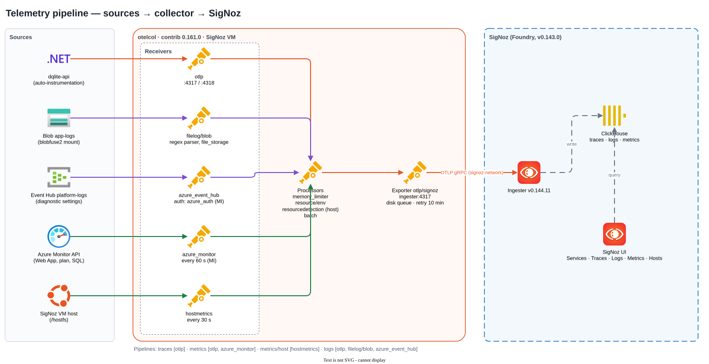

# SigNoz POC – End-to-End Implementation, Architecture, Testing & Troubleshooting

A self-hosted SigNoz stack on Azure, fed by OpenTelemetry from a data-quality style .NET 8 application on private App Service, plus Azure platform logs and metrics. Everything below is taken from the deployed environment, its Terraform state, the code in this repository, and the command output recorded during the build.

| | |
| --- | --- |
| **Status** | Phases 1–3 (Stages A–C) complete · Stage D (dashboards, alerts, formal tests) pending |
| **Dates** | 29–30 Sept 2026 |
| **Environment** | Terraform workspace `poc-centralindia` · Azure free-trial subscription |
| **Diagrams** | [`diagrams/architecture.drawio.svg`](diagrams/architecture.drawio.svg) · [`diagrams/telemetry-pipeline.drawio.svg`](diagrams/telemetry-pipeline.drawio.svg) |

> **Editing the diagrams.** Both diagrams are `.drawio.svg` files: a normal SVG image that also contains the editable draw.io diagram. Open them in draw.io desktop, the VS Code *Draw.io Integration* extension, or app.diagrams.net, edit and save. The images in this document update automatically, so there is nothing to export.

## Contents

1. [Executive summary](#1-executive-summary)
2. [Proposed vs implemented architecture](#2-proposed-vs-implemented-architecture)
3. [Azure infrastructure](#3-azure-infrastructure)
4. [Terraform implementation](#4-terraform-implementation)
5. [Application — DQ Lite](#5-application--dq-lite)
6. [OpenTelemetry implementation](#6-opentelemetry-implementation)
7. [SigNoz setup](#7-signoz-setup)
8. [Testing performed](#8-testing-performed)
9. [Errors and troubleshooting](#9-errors-and-troubleshooting)
10. [Troubleshooting timeline](#10-troubleshooting-timeline)
11. [Security](#11-security)
12. [Cost](#12-cost)
13. [Production considerations](#13-production-considerations)
14. [Final architecture and flows](#14-final-architecture-and-flows)
15. [Final POC result](#15-final-poc-result)

---

## 1. Executive summary

### Purpose and objective

Many hosted .NET platforms run without application monitoring, alerting or dashboards, and Azure-native options such as Log Analytics can be expensive at scale. This POC tests whether **SigNoz with OpenTelemetry** can provide traces, metrics and logs for a typical hosted .NET workload on Azure: a single .NET 8 container on App Service, Azure SQL, Key Vault, Blob storage and private endpoints, with a central collection design.

### What we set out to validate

- Application telemetry from a .NET 8 container with **OpenTelemetry auto-instrumentation and no code change**, a "one image change" path for applications whose code cannot change.
- Legacy-style **plain-text log files in Blob storage** ingested into SigNoz.
- Azure **platform logs** through diagnostic settings → Event Hub, and **platform metrics** from the Azure Monitor API, both with managed identity.
- A fully **private** network: no public endpoints on the app, database, storage, Event Hub or SigNoz.
- Reproducible infrastructure in Terraform, one file per component.

### What was implemented

| Measure | Value |
| --- | --- |
| Azure resources, all from Terraform | **48**, in 2 regions |
| Telemetry sources flowing into SigNoz | **6** |
| Lines of OpenTelemetry code in the app | **0** |
| Issues diagnosed and resolved | **20** |

The final environment runs in **Central India** (main stack) with a Windows support VM in **South India**. The original target region, UK South, was blocked by Azure free-trial restrictions (§9). SigNoz v0.143.0 runs self-hosted on one VM, installed with SigNoz's current installer (Foundry), and receives data through an OpenTelemetry Collector (contrib 0.161.0) on the same VM.

### Key outcome

> **The collection architecture works end to end.** Application traces, application metrics, application logs with trace correlation, Blob text logs, Azure Monitor metrics, Azure diagnostic logs and host metrics all arrive in SigNoz, with every Azure-side credential handled by managed identity.

| Finding | Why it matters |
| --- | --- |
| Auto-instrumentation of a .NET 8 container needs only an image layer plus app settings | Confirms the lowest-effort path for teams with infrequent releases or no code access |
| Private Event Hubs silently drop diagnostic logs unless **trusted Microsoft services** is enabled | Must be set on every production namespace, or platform logs are lost with no error |
| Event Hub managed-identity auth needs collector-contrib **≥ 0.161** (0.135 needed a connection string) | Allows a keyless production design |
| SigNoz's ingester stays closed until the first admin signs up | Installation runbooks must include the sign-up step before data can flow |
| SigNoz Docker Compose install is deprecated; Foundry is the supported installer | Production runbooks should be written for Foundry |
| Free-trial subscriptions block VM capacity, SQL, App Service and ACR Tasks in UK South | A production-like POC should run on a pay-as-you-go subscription in the target region |

**Not yet done:** dashboards, alert rules and the formal test run with load, restart and evidence capture (Stage D). See §15.

---

## 2. Proposed vs implemented architecture

### 2.1 Original proposal

The reference target architecture covers a multi-environment estate in UK South: a central OpenTelemetry Collector on Azure Container Apps, one shared Event Hub fed by diagnostic settings, the `azuremonitor` receiver across all subscriptions, SigNoz either self-hosted or on SigNoz Cloud, and alert rules grouped by `tenant.id` and `deployment.environment`.

The first POC plan was then reduced, at the team's request, to a small three-phase build that can run for 1–3 days on a free-trial subscription.

### 2.2 Implemented POC


*Source: [`diagrams/architecture.drawio.svg`](diagrams/architecture.drawio.svg) (editable in draw.io). §14 walks through every flow.*

### 2.3 Differences and reasons

| Area | Proposed | Implemented | Reason |
| --- | --- | --- | --- |
| Scale | Many environments and subscriptions | 1 environment, 1 subscription | POC scope; volumes are to be measured and multiplied |
| Region | UK South | Central India (+ South India support VM) | UK South refused VMs, SQL and App Service on the free trial (issues 4–6) |
| Collector | Central, on Container Apps | On the SigNoz VM (Docker) | Agreed simplification; Container Apps remains an optional Phase 4 |
| SigNoz | Self-hosted HA (AKS) or SigNoz Cloud | Self-hosted, single VM, Foundry | Smallest footprint that proves the self-hosted path |
| Access | Private, existing access paths | Bastion Standard → Windows support VM (peered VNet) | No public IPs on workloads; one browser-capable jump host |
| App | Real production application | DQ Lite, a data-quality demo (.NET 8, EF Core, Azure SQL, Blob text logs) | No production code or data in the POC |
| Event Hub | Standard, shared | Standard, private endpoint, trusted services on | Standard is the lowest tier with private endpoints |
| VPN, secret expiry, scheduler, SMTP checks | In scope for alerts | Out of scope | Agreed to keep the POC small |
| SQL tier | Production tier | Basic (5 DTU) | Cost; free SQL offer could not be set cleanly from Terraform |

---

## 3. Azure infrastructure

All resources are in resource group `rg-sigpoc-poc-cin`, created by Terraform workspace `poc-centralindia`. Globally unique names carry a random 5-character suffix (shown as `xxxxx`). Names follow `{type}-{project}-{environment}-{region}`.

### 3.1 Resource inventory

| Component | Azure name | Terraform resource | Region |
| --- | --- | --- | --- |
| Resource group | `rg-sigpoc-poc-cin` | `azurerm_resource_group.main` | centralindia |
| Main VNet | `vnet-sigpoc-poc-cin` (10.20.0.0/16) | `azurerm_virtual_network.main` | centralindia |
| Support VNet | `vnet-sigpoc-poc-sin` (10.30.0.0/16) | `azurerm_virtual_network.support` | southindia |
| VNet peering ×2 | `peer-sigpoc-poc-cin-to-sigpoc-poc-sin` and reverse | `azurerm_virtual_network_peering.*` | — |
| Subnets ×5 | see 3.2 | `azurerm_subnet.*` | both |
| NSGs ×2 | `nsg-signoz-sigpoc-poc-cin`, `nsg-support-sigpoc-poc-sin` | `azurerm_network_security_group.*` | both |
| Bastion (Standard, tunnelling on) | `bas-sigpoc-poc-cin` + `pip-bas-sigpoc-poc-cin` | `azurerm_bastion_host.main`, `azurerm_public_ip.bastion` | centralindia |
| SigNoz VM | `vm-signoz-sigpoc-poc-cin`, Standard_B4as_v2 (4 vCPU/16 GB), Ubuntu 24.04, 64 GB Premium SSD, 10.20.1.10 | `azurerm_linux_virtual_machine.signoz` | centralindia |
| Support VM | `vm-support-sigpoc-poc-sin`, Standard_B2s_v2 (2 vCPU/8 GB), Windows Server 2022, 10.30.1.10 | `azurerm_windows_virtual_machine.support` | southindia |
| VM auto-shutdown ×2 | 19:00 India Standard Time | `azurerm_dev_test_global_vm_shutdown_schedule.*` | both |
| App Service plan | `asp-sigpoc-poc-cin`, Linux B1 | `azurerm_service_plan.main` | centralindia |
| Web App | `app-dqlite-sigpoc-poc-cin-xxxxx`, container `dqlite-api:v1` | `azurerm_linux_web_app.api` | centralindia |
| Container registry | `crsigpocpocxxxxx`, Basic, admin user off | `azurerm_container_registry.main` | centralindia |
| SQL logical server | `sql-sigpoc-poc-cin-xxxxx`, TLS 1.2, public access off | `azurerm_mssql_server.main` | centralindia |
| SQL database | `sqldb-dqlite`, Basic, 2 GB, LRS backups | `azurerm_mssql_database.main` | centralindia |
| Storage account | `stsigpocpocxxxxx`, LRS, shared keys off, public access off; container `app-logs` | `azurerm_storage_account.main`, `azurerm_storage_container.app_logs` | centralindia |
| Event Hubs namespace | `evhns-sigpoc-poc-cin-xxxxx`, Standard, 1 TU, trusted services on | `azurerm_eventhub_namespace.main` | centralindia |
| Event hub + consumer group | `platform-logs` (2 partitions, 1 day), group `otelcol` | `azurerm_eventhub.platform_logs`, `azurerm_eventhub_consumer_group.otelcol` | centralindia |
| Key Vault | `kv-sigpoc-poc-xxxxx`, RBAC mode, soft-delete 7 days | `azurerm_key_vault.main` | centralindia |
| Key Vault secrets ×4 | sql-admin-password, sql-connection-string, support-vm-admin-password, signoz-vm-ssh-private-key | `azurerm_key_vault_secret.*` | — |
| Private endpoints ×5 | `pe-{webapp,sql,blob,eventhub,keyvault}-sigpoc-poc-cin` | `azurerm_private_endpoint.*` | centralindia |
| Private DNS zones ×5 + 10 links | privatelink.{azurewebsites.net, database.windows.net, blob.core.windows.net, servicebus.windows.net, vaultcore.azure.net} | `azurerm_private_dns_zone.zones`, `…_virtual_network_link.{main,support}` | global |
| Diagnostic settings ×2 | `diag-to-eventhub` on Web App and SQL database (allLogs) | `azurerm_monitor_diagnostic_setting.*` | — |
| Role assignments ×8 | see 3.4 | `azurerm_role_assignment.*` | — |

There is **no load balancer**. App Service provides its own front end (reached only through its private endpoint) and Bastion provides administrative access. Azure also created the VM OS disks and the private endpoints' network interfaces.

### 3.2 Networking

| Subnet | CIDR | Purpose | Connects to |
| --- | --- | --- | --- |
| `AzureBastionSubnet` | 10.20.0.0/26 | Bastion host (name required by Azure) | RDP to support VM (over peering), SSH to SigNoz VM |
| `snet-signoz` | 10.20.1.0/24 | SigNoz VM, NSG attached | Receives OTLP from the app; reaches private endpoints and Azure APIs |
| `snet-app-integration` | 10.20.2.0/26 | Web App outbound VNet integration, delegated to `Microsoft.Web/serverFarms`, route-all on | SQL, Key Vault, Blob private endpoints; SigNoz VM :4318 |
| `snet-private-endpoints` | 10.20.3.0/27 | Private endpoints: Event Hub .4, SQL .5, Blob .6, Key Vault .7, Web App .8 (observed) | Resolved through the private DNS zones |
| `snet-support` (support VNet) | 10.30.1.0/24 | Windows support VM, NSG attached | Peered to the main VNet; DNS zones linked |

**NSG rules (inbound)**

| NSG | Priority | Rule | Source | Ports |
| --- | ---: | --- | --- | --- |
| `nsg-signoz-…-cin` | 100 | allow-ssh-from-bastion | 10.20.0.0/26 | 22 |
| | 110 | allow-from-support-vm | 10.30.1.0/24 | 22, 8080 |
| | 120 | allow-otlp-from-webapp | 10.20.2.0/26 | 4317, 4318 |
| | 4000 | deny-vnet-inbound | VirtualNetwork | all |
| `nsg-support-…-sin` | 100 | allow-rdp-from-bastion | 10.20.0.0/26 | 3389 |
| | 4000 | deny-vnet-inbound | VirtualNetwork | all |

### 3.3 Component details

| Component | Purpose | Configuration | Why required | Connections |
| --- | --- | --- | --- | --- |
| Bastion | Admin access without public IPs on VMs | Standard SKU, `tunneling_enabled`; toggle `enable_bastion` | Standard is needed to reach a VM in a peered VNet | Portal RDP/SSH → support VM, SigNoz VM |
| Support VM | Browser and tools inside the network | Windows, private IP only, password in Key Vault | The Web App and SigNoz UI are only reachable privately | Edge → Web App PE, SigNoz UI :8080 |
| SigNoz VM | Runs the OTel Collector and SigNoz | System-assigned identity; cloud-init installs Docker, az CLI, blobfuse2 | Single-node self-hosted SigNoz | Receives OTLP; reads Blob, Event Hub, Azure Monitor |
| Web App | Hosts DQ Lite as a typical containerised .NET app | Linux container from ACR via identity; public access off; health `/healthz`; OTel app settings | Representative App Service hosting | SQL, Key Vault, Blob, SigNoz VM |
| ACR | Stores the app image | Basic, admin off, AcrPull for the Web App | Image-based deployment | Web App pulls over the public endpoint (Basic has no PE) |
| Azure SQL | App database | Basic, private only, SQL login stored in Key Vault | Real database spans and platform metrics | Web App via PE; diagnostic logs → Event Hub |
| Storage | Plain-text app logs | Container `app-logs`, Entra auth only | Many legacy apps write text logs to Blob | Web App writes; SigNoz VM reads (blobfuse2) |
| Event Hub | Transport for platform logs | Standard, PE, trusted services, group `otelcol` | Diagnostic settings target | Web App and SQL diagnostic settings → collector |
| Key Vault | Secrets | RBAC; public endpoint kept on for the Terraform runner | No secrets in code or tfvars | Web App KV reference over PE |

### 3.4 Managed identities and role assignments

| Principal | Role | Scope | Used for |
| --- | --- | --- | --- |
| Web App (system-assigned) | AcrPull | ACR | Pull `dqlite-api` image |
| Web App | Key Vault Secrets User | Key Vault | Connection-string reference |
| Web App | Storage Blob Data Contributor | Storage account | Write text log files |
| SigNoz VM (system-assigned) | Storage Blob Data Reader | Storage account | blobfuse2 mount of `app-logs` |
| SigNoz VM | Azure Event Hubs Data Receiver | Event Hub namespace | `azure_event_hub` receiver |
| SigNoz VM | Monitoring Reader | Resource group | `azure_monitor` receiver |
| Terraform runner (signed-in user) | Key Vault Secrets Officer | Key Vault | Write generated secrets |
| Terraform runner | Storage Blob Data Contributor | Storage account | Container management with Entra auth |

---

## 4. Terraform implementation

### 4.1 Repository structure

One flat stack, **one file per component**, no modules. Reuse across regions and accounts comes from variables and per-deployment `.tfvars` files.

```text
deploy/terraform/azure/infra/
  providers.tf      main.tf        variables.tf     outputs.tf
  network.tf        dns.tf         bastion.tf       signoz_vm.tf     support_vm.tf
  webapp.tf         acr.tf         sql_server.tf    storageaccount.tf
  keyvault.tf       secret.tf      eventhub.tf      diagnostics.tf   rbac.tf
  scripts/cloud-init-signoz.yaml
  environments/poc-centralindia.tfvars   example.tfvars
app/          Dockerfile  deploy.sh  src/DqLite.Api/…
collector/    otel-collector-config.yaml  docker-compose.yaml  install.sh  .env.example
signoz/       casting.yaml
docs/         signoz-poc-report.md  diagrams/*.drawio.svg
```

### 4.2 Providers and state

| Item | Setting |
| --- | --- |
| Terraform | ≥ 1.9 (run with 1.16.4) |
| Providers | `azurerm ~> 4.0`, `random ~> 3.6`, `tls ~> 4.0`, `local ~> 2.5` |
| azurerm features | `storage_use_azuread = true`; Key Vault purge on destroy; resource group deletable with contents |
| State | Local backend, one **workspace** per deployment (`terraform.tfstate.d/<workspace>/`), git-ignored because it holds generated secrets. Remote state in Blob (a separate bootstrap stack) was discussed and deferred for a single-user, 3-day POC; migration is `terraform init -migrate-state` |

### 4.3 Variables

| Group | Variables | Value in `poc-centralindia.tfvars` |
| --- | --- | --- |
| Account | `subscription_id`, `tenant_id` | your subscription; tenant from login |
| Naming | `project` (2–8 chars, validated), `environment` (2–6) | `sigpoc`, `poc` |
| Regions | `location`, `location_short`, `support_location`, `support_location_short` | centralindia/cin, southindia/sin |
| Network | `vnet_address_space`, `subnet_prefixes` (object), `support_vnet_address_space`, `support_subnet_prefix` | 10.20.0.0/16 …, 10.30.0.0/16 |
| VMs | `signoz_vm_size`, `signoz_vm_private_ip`, `signoz_vm_disk_size_gb`, `support_vm_size`, `support_vm_private_ip`, `support_vm_admin_username` | B4as_v2, 10.20.1.10, 64; B2s_v2, 10.30.1.10, dqadmin |
| Switches | `enable_bastion`, `enable_support_vm`, `auto_shutdown_time`, `auto_shutdown_timezone` | true, true, 1900, India Standard Time |
| SKUs | `bastion_sku`, `app_service_sku`, `acr_sku`, `sql_sku`, `eventhub_sku`, `storage_replication_type` | defaults: Standard, B1, Basic, Basic, Standard, LRS |
| Application | `app_image`, `app_port`, `app_test_endpoints_enabled`, `otel_service_name`, `otel_tenant` | `dqlite-api:v1`, 8080, true, dqlite-api, demo |
| Tags | `owner`, `expiry`, `extra_tags` | `<owner>`, 2026-10-03 |

Outputs include `resource_group`, `webapp_url`, `acr_name`, `acr_login_server`, `sql_server_fqdn`, `key_vault_name`, `storage_account`, `eventhub_namespace`, `signoz_vm_private_ip`, `signoz_ui_url`, `support_vm_login` and a ready-made `signoz_vm_ssh_command`.

### 4.4 Secrets handling

- Passwords are generated by `random_password` in `secret.tf` and written only to the deployment's own Key Vault.
- The SigNoz VM SSH key is generated by `tls_private_key`, saved to git-ignored `.ssh/` (mode 0600) and copied to Key Vault.
- The app reads its connection string through a Key Vault reference: `@Microsoft.KeyVault(VaultName=…;SecretName=sql-connection-string)`.
- Nothing secret appears in `.tfvars` or git. The state file and `.ssh/` are the only local copies.

### 4.5 Deployment sequence and dependencies

```text
random suffix ─► resource group ─► VNets, subnets, NSGs ─► private DNS zones + links ─► peering
                                 ├─► Key Vault ─► runner role ─► secrets
                                 ├─► ACR, storage (+container), Event Hub (+hub, group)
                                 ├─► SQL server ─► database ─► connection-string secret
                                 ├─► SigNoz VM (cloud-init) ─► VM roles (Blob, Event Hub, Monitoring Reader)
                                 ├─► support VM (password from secret.tf)
                                 ├─► App Service plan ─► Web App ─► roles (AcrPull, KV, Blob)
                                 ├─► private endpoints (Web App, SQL, Blob, Event Hub, KV)
                                 └─► diagnostic settings (Web App, SQL → Event Hub)
```

### 4.6 Commands

```bash
cd deploy/terraform/azure/infra
az login && az account set --subscription <id>
terraform init
terraform workspace select poc-centralindia        # or: workspace new <name>
terraform workspace show                           # always confirm before plan/apply/destroy
terraform plan  -var-file=environments/poc-centralindia.tfvars -out=poc-centralindia.tfplan
terraform apply poc-centralindia.tfplan
terraform output
```

**New region or account:** copy `environments/example.tfvars`, set the subscription, regions and address ranges, create a workspace of the same name, and plan/apply. No code changes are needed. This is exactly how the move from UK South to Central India was done.

### 4.7 Destroy and cleanup

```bash
terraform workspace select poc-centralindia
terraform destroy -var-file=environments/poc-centralindia.tfvars
az group show -n rg-sigpoc-poc-cin   # expect ResourceNotFound
```

The UK South workspace was destroyed on 29 Sept after the region move. Key Vault is purged on destroy by the provider setting. Before destroying, export dashboard and alert JSON and record the volume measurements (§15).

---

## 5. Application — DQ Lite

DQ Lite is a small data-quality app: **datasets**, **rules** that check them, and **rule runs** with results. It exists to generate realistic, controllable telemetry.

### 5.1 Stack

| Layer | Technology |
| --- | --- |
| Front end | Static page `wwwroot/index.html` served by the same app: rules list, Run now, add/delete, recent runs, a button per fault test |
| Back end | ASP.NET Core 8 minimal API (`Program.cs`) |
| Data access | EF Core 8 with SQL Server provider, retry on failure (3) |
| Database | Azure SQL `sqldb-dqlite`; schema via `EnsureCreated`; seeded on first start with 1 dataset, 4 rules, 20,000 sample rows (~5% deliberately bad) |
| Text logs | `BlobTextLoggerProvider`: every 30 s uploads a block blob `app-logs/yyyy/MM/dd/app-HHmmss-<instance>.log` with managed identity |
| Image | `mcr.microsoft.com/dotnet/aspnet:8.0` + OpenTelemetry .NET auto-instrumentation v1.17.0; port 8080 |

### 5.2 Endpoints

| Method | Path | Behaviour | Telemetry it produces |
| --- | --- | --- | --- |
| GET | `/healthz` | DB connectivity check; 200 or 503 | Health check target |
| GET | `/api/datasets`, `/api/datasets/{id}` | List / read | SQL SELECT spans |
| GET/POST | `/api/rules` | List / create with validation | 201, or 400 with problem details |
| GET/PUT/DELETE | `/api/rules/{id}` | Read / update / delete | 200, 204, 404 |
| POST | `/api/rules/{id}/run` | Runs the rule as a real SQL query, stores a `RuleRun` | Custom span `RuleRun {name}`, `dq.*` metrics, info log |
| GET | `/api/runs?ruleId=&status=` | Last 100 runs | SQL spans |
| GET | `/api/test/status/{code}` | Returns any status code | 4xx/5xx spans, warning log |
| GET | `/api/test/error` | 500 problem response | Error span, error log |
| GET | `/api/test/exception` | Unhandled `InvalidOperationException` wrapping `TimeoutException` | Exception event, 500 |
| GET | `/api/test/slow?ms=` | `Task.Delay` (max 30 s) | Slow server span, no DB time |
| GET | `/api/test/slow-sql?seconds=` | `WAITFOR DELAY` (max 25 s) | Slow SQL span inside the request |
| GET | `/api/test/db-fail` | Opens a connection with a wrong password | Real `SqlException` 18456 (login failed) |

The `/api/test/*` group is registered only when `TEST_ENDPOINTS_ENABLED=true` (Terraform `app_test_endpoints_enabled`).

### 5.3 Designed for observability

- **Real database work:** rules count failures over 20,000 rows, so SQL spans carry real latency and statement text.
- **Custom signals without an OpenTelemetry package:** `ActivitySource` and `Meter` named `DqLite.Api` from `System.Diagnostics`, picked up by the agent through `OTEL_DOTNET_AUTO_*_ADDITIONAL_SOURCES`. Metrics: `dq.rule_runs` (counter), `dq.rule_run.duration` (ms histogram), `dq.rule_run.failed_rows` (histogram).
- **Two log paths**, as a typical legacy app would have: structured `ILogger` logs over OTLP (with trace IDs), and plain text files in Blob.
- **Controlled faults:** each failure mode in the test plan has its own endpoint and UI button.
- **Log volume control:** `appsettings.json` sets ASP.NET Core and EF Core categories to Warning, which removed per-request framework noise found in the local test.

### 5.4 Build and deployment

```bash
# build locally (ACR Tasks are blocked on free trial) and push
./app/deploy.sh v1          # docker build --platform linux/amd64 → az acr login → docker push
# then in environments/poc-centralindia.tfvars:
#   app_image = "dqlite-api:v1"
terraform apply -var-file=environments/poc-centralindia.tfvars
```

Before Azure deployment the image was tested locally with SQL Server 2022 and the collector in Docker. Every endpoint returned the expected status, and all four rules found failures (101, 572, 374, 179 rows).

---

## 6. OpenTelemetry implementation

### 6.1 Instrumentation approach

The application contains **no OpenTelemetry code or packages**. The Dockerfile adds the official auto-instrumentation release, and App Service app settings configure it. This is the "one image change" path.

```dockerfile
ARG OTEL_DOTNET_AUTO_VERSION=v1.17.0
ENV OTEL_DOTNET_AUTO_HOME=/otel-dotnet-auto
RUN … curl -sSfL ".../releases/download/${OTEL_DOTNET_AUTO_VERSION}/otel-dotnet-auto-install.sh" -o /tmp/otel-install.sh \
 && SKIP_RELEASE_VERIFICATION=true sh /tmp/otel-install.sh …
ENV CORECLR_ENABLE_PROFILING=1 \
    CORECLR_PROFILER={918728DD-259F-4A6A-AC2B-B85E1B658318} \
    CORECLR_PROFILER_PATH=/otel-dotnet-auto/linux-x64/OpenTelemetry.AutoInstrumentation.Native.so \
    DOTNET_STARTUP_HOOKS=/otel-dotnet-auto/net/OpenTelemetry.AutoInstrumentation.StartupHook.dll
```

**App settings (from `webapp.tf`)**

| Setting | Value |
| --- | --- |
| `OTEL_SERVICE_NAME` | `dqlite-api` |
| `OTEL_RESOURCE_ATTRIBUTES` | `deployment.environment=poc,tenant.id=demo,cloud.region=centralindia` |
| `OTEL_EXPORTER_OTLP_ENDPOINT` | `http://10.20.1.10:4318` (built from `var.signoz_vm_private_ip`) |
| `OTEL_EXPORTER_OTLP_PROTOCOL` | `http/protobuf` |
| `OTEL_TRACES/METRICS/LOGS_EXPORTER` | `otlp` |
| `OTEL_DOTNET_AUTO_TRACES_ADDITIONAL_SOURCES`, `…_METRICS_ADDITIONAL_SOURCES` | `DqLite.Api` |
| `OTEL_DOTNET_AUTO_SQLCLIENT_SET_DBSTATEMENT_FOR_TEXT` | `true` |

### 6.2 Collector

`otel/opentelemetry-collector-contrib:0.161.0` runs in Docker on the SigNoz VM (`collector/docker-compose.yaml`). It publishes 4317/4318/13133, joins `signoz-network`, mounts `/mnt/app-logs` (blobfuse2) and the VM root at `/hostfs` read-only, and uses `pid: host` for host metrics. Azure settings come from a `.env` file (subscription, resource group, Event Hub namespace).



*Source: [`diagrams/telemetry-pipeline.drawio.svg`](diagrams/telemetry-pipeline.drawio.svg) (editable in draw.io).*

| Pipeline | Receivers | Processors | Exporters |
| --- | --- | --- | --- |
| traces | `otlp` | memory_limiter, resource/env, batch | `otlp/signoz`, debug |
| metrics | `otlp`, `azure_monitor` | memory_limiter, resource/env, batch | `otlp/signoz`, debug |
| metrics/host | `hostmetrics` | memory_limiter, resourcedetection/host, resource/env, batch | `otlp/signoz`, debug |
| logs | `otlp`, `filelog/blob`, `azure_event_hub` | memory_limiter, resource/env, batch | `otlp/signoz`, debug |

**Key configuration** (full file: [`collector/otel-collector-config.yaml`](../collector/otel-collector-config.yaml))

```yaml
extensions:
  file_storage: { directory: /var/lib/otelcol/storage, create_directory: true }
  azure_auth:   { managed_identity: {} }          # VM identity via IMDS

receivers:
  otlp: { protocols: { grpc: { endpoint: 0.0.0.0:4317 }, http: { endpoint: 0.0.0.0:4318 } } }
  filelog/blob:                                     # plain-text app logs
    include: [/mnt/app-logs/**/*.log]
    start_at: beginning
    storage: file_storage
    operators:
      - type: regex_parser
        regex: '^(?P<time>\d{4}-\d{2}-\d{2} \d{2}:\d{2}:\d{2}\.\d{3}) \[(?P<level>[A-Z]{3})\] (?P<category>[^:]+): (?P<message>.*)$'
  azure_monitor:
    subscription_ids: ["${env:AZURE_SUBSCRIPTION_ID}"]
    resource_groups:  ["${env:AZURE_RESOURCE_GROUP}"]
    services: [Microsoft.Web/sites, Microsoft.Web/serverFarms, Microsoft.Sql/servers/databases]
    auth: { authenticator: azure_auth }
    collection_interval: 60s
  azure_event_hub:
    auth: azure_auth
    event_hub: { namespace: ${env:EVENTHUB_NAMESPACE}.servicebus.windows.net, name: platform-logs }
    group: otelcol
    format: azure
  hostmetrics: { root_path: /hostfs, collection_interval: 30s, scrapers: { cpu, load, memory, disk, filesystem, network, paging, processes } }

exporters:
  otlp/signoz:
    endpoint: ingester:4317          # SigNoz collector on signoz-network
    tls: { insecure: true }
    sending_queue: { enabled: true, storage: file_storage }
    retry_on_failure: { enabled: true, max_elapsed_time: 10m }
```

### 6.3 How telemetry reaches SigNoz

| Signal | Path | Auth |
| --- | --- | --- |
| App traces, metrics, logs | Web App → VNet integration → `10.20.1.10:4318` (OTLP/HTTP) → collector → `ingester:4317` → ClickHouse | Network only (NSG allows the app subnet) |
| Blob text logs | App → Blob PE → `app-logs`; blobfuse2 on VM → `filelog/blob` → ingester | Managed identity both sides |
| Azure platform logs | Diagnostic settings → Event Hub (trusted services) → `azure_event_hub` via PE → ingester | VM managed identity (Data Receiver) |
| Azure platform metrics | Azure Monitor REST API → `azure_monitor` every 60 s → ingester | VM managed identity (Monitoring Reader) |
| Host metrics | VM `/hostfs` → `hostmetrics` + `resourcedetection` → ingester | Local |

---

## 7. SigNoz setup

### 7.1 Deployment

SigNoz's `deploy/` Docker Compose files are deprecated. The supported installer is **Foundry** (`foundryctl`), driven by [`signoz/casting.yaml`](../signoz/casting.yaml). `forge` generates `pours/deployment/compose.yaml` without touching containers, and `cast` applies it.

```bash
curl -fsSL https://signoz.io/foundry.sh | bash
install -m 0755 /root/.local/bin/foundryctl /usr/local/bin/foundryctl
foundryctl forge -f casting.yaml     # inspect pours/deployment/compose.yaml
foundryctl cast  -f casting.yaml
```

```yaml
spec:
  deployment: { flavor: compose, mode: docker }
  signoz: { spec: { image: signoz/signoz:v0.143.0 } }
  patches:
    - target: "deployment/compose.yaml"
      operations:
        - { op: remove,  path: /services/ingester/ports }        # our collector owns 4317/4318
        - { op: replace, path: /services/ingester/image, value: signoz/signoz-otel-collector:v0.144.11 }
        - { op: replace, path: /services/signoz-telemetrystore-migrator/image, value: signoz/signoz-otel-collector:v0.144.11 }
        - { op: add,     path: /services/signoz-telemetrystore-clickhouse-0-0/mem_limit, value: 8g }
```

### 7.2 Components (running)

| Container | Image | Role |
| --- | --- | --- |
| `signoz-signoz-0` | signoz/signoz:v0.143.0 | Query service, UI (:8080), alerting, OpAMP server |
| `signoz-ingester-1` | signoz/signoz-otel-collector:v0.144.11 | SigNoz collector, writes to ClickHouse; no host ports |
| `signoz-telemetrystore-clickhouse-0-0` | clickhouse/clickhouse-server:25.12.5 | Telemetry store (traces, logs, metrics), 8 GB memory cap |
| `signoz-telemetrykeeper-clickhousekeeper-0` | clickhouse/clickhouse-keeper:25.12.5 | Coordination (replaces ZooKeeper) |
| `signoz-metastore-postgres-0` | postgres:16 | Metadata store (users, dashboards, alerts) |
| `signoz-telemetrystore-migrator` | signoz/signoz-otel-collector:v0.144.11 | Schema migrations; exited 0 |
| `otelcol` (ours) | otel/opentelemetry-collector-contrib:0.161.0 | Edge collector for all sources |

### 7.3 Verification that data reached SigNoz

Verification used three independent checks: collector logs (export errors), direct ClickHouse queries, and the SigNoz UI. Snapshot taken on 29 Sept 2026 after Stage C:

| Measure | Value | Source |
| --- | ---: | --- |
| Spans from `dqlite-api` | 214 | `signoz_traces.distributed_signoz_index_v3` |
| Error spans | 31 | same, `hasError` |
| p95 span duration | 2,013 ms | skewed by the deliberate slow tests |
| Log records (all sources) | 332 | `signoz_logs.distributed_logs_v2` |
| Blob text log records | 64 | `resources_string['log.source']='blob'` |
| Azure diagnostic log records by category (30 min after fix) | 155 / 21 / 1 | AppServiceConsoleLogs / AppServiceHTTPLogs / DatabaseWaitStatistics |
| Metric names (total / Azure / host) | 266 / 156 / 26 | `signoz_metrics.distributed_time_series_v4` |
| ClickHouse disk used (all SigNoz DBs) | ≈ 0.9 MB | `system.parts`, about 1 h of POC traffic |
| Collector export errors after sign-up | 0 | `docker logs otelcol` |

### 7.4 Features: status

| Feature | Status | Notes |
| --- | --- | --- |
| Services (APM) | ✅ Data present | `dqlite-api` with rate, errors, latency |
| Traces | ✅ Data present | HTTP → RuleRun → SQL span trees; SQL statement text |
| Logs | ✅ Data present | OTLP, Blob and Azure diagnostic logs |
| Metrics | ✅ Data present | App, `dq.*`, Azure, host |
| Infrastructure → Hosts | ✅ Data present | After hostmetrics fix (issue 20) |
| Service map | ⏳ Not recorded | Expected to show `dqlite-api` → SQL; to be captured in Stage D |
| Dashboards | ⏳ Pending | Stage D |
| Alerts | ⏳ Pending | Stage D; email channel to configure |
| Retention | ℹ️ Default | Left at defaults by decision, environment is short-lived |

---

## 8. Testing performed

> **Scope of this section.** The tests below were run as scripted `curl` traffic from inside the VNet (via `az vm run-command` on the SigNoz VM) and in a local Docker test, with results checked in collector output and ClickHouse. The formal Stage D run (k6 load, planned restart, alert firing, screenshots) has **not been executed yet**. Tests not yet run are marked as such.

### 8.1 Infrastructure checks (Phase 1)

| Test | Action | Expected | Actual | Status |
| --- | --- | --- | --- | --- |
| Private DNS | `dig` from SigNoz VM | Private IPs | Web App 10.20.3.8, SQL .5, Blob .6, Event Hub .4, KV .7 | ✅ Pass |
| Web App private | `curl` from laptop | Blocked | HTTP 403 | ✅ Pass |
| Web App from VNet | `curl` from VM | 200 | 200 | ✅ Pass |
| SQL / Event Hub ports | `nc` 1433 / 5671 | Open | Both succeeded | ✅ Pass |
| Bastion → support VM | Portal RDP | Desktop | Used for SigNoz sign-up and UI checks | ✅ Pass |
| Event Hub receiving | Metric IncomingMessages | > 0 | 0 until issue 19 fixed, then messages arriving | ✅ Pass after fix |

### 8.2 Application and telemetry tests

| Test | Action | Expected result | Actual result | SigNoz evidence | Status |
| --- | --- | --- | --- | --- | --- |
| Normal traffic | Loops of list/read/run calls, rule CRUD | 2xx, spans with SQL children | Rules list 200; runs 200 (e.g. rule 1: 1,017 failed rows, 1.1 s in Azure); create 201, update 200, delete 204 | Server spans per route; `POST /api/rules/{id:int}/run` avg 101 ms | ✅ Pass |
| 4xx errors | `/api/test/status/404`, invalid rule body, missing id | 4xx, not counted as server errors | 404, 400 with validation errors, 404 | Span `GET /api/test/status/{code:int}`; warning logs | ✅ Pass |
| 5xx errors | `/api/test/error` | 500, error span, error log | 500 problem details | Included in 31 error spans; error log "Test endpoint returning 500" | ✅ Pass |
| Slow API | `/api/test/slow?ms=1500–3000` | Long server span, no DB time | 2.0 s locally | `GET /api/test/slow` avg 1,505 ms | ✅ Pass |
| Database latency | `/api/test/slow-sql?seconds=1–3` | SQL span dominates | 3.0 s locally | `GET /api/test/slow-sql` avg 1,605 ms; `db.query.text` "WAITFOR DELAY ?" (local) | ✅ Pass |
| DB connection failure | `/api/test/db-fail` (wrong password) | SqlException, 500 | 500; real login failure | `GET /api/test/db-fail` error spans, avg 578 ms | ✅ Pass (endpoint variant) |
| Exceptions | `/api/test/exception` | Exception recorded, 500 | 500 | Exception events seen in collector output (local); error spans in SigNoz | ✅ Pass |
| Trace correlation | Run a rule | One trace: HTTP → RuleRun → SQL; logs share trace id | Confirmed locally: span tree and 50 log records carrying trace ids | Span names `RuleRun Email not null`, `SELECT [SampleRows]`, `INSERT` | ✅ Pass (server-side) |
| Blob text logs | App writes files; collector reads | Parsed timestamp/severity/message | 6 files within minutes; parsed INF/ERR with category | 64 records with `log.source=blob` | ✅ Pass |
| Azure platform metrics | azure_monitor receiver | Web App and SQL metrics | 156 metric names | `azure_averageresponsetime_*`, `azure_bytesreceived_*`, … | ✅ Pass |
| Azure platform logs | Diagnostic settings → Event Hub | Logs in SigNoz | Arriving after issue 19 fix | AppServiceConsoleLogs 155, AppServiceHTTPLogs 21, DatabaseWaitStatistics 1 | ✅ Pass |
| Host metrics | hostmetrics receiver | Hosts page populated | All required metrics and `host.name` present | `system.cpu.time` 8 series, `host.name=vm-signoz-sigpoc-poc-cin` | ✅ Pass |
| DB failure, config variant | Wrong SQL password in app setting for 5 min | Health 503, alert | — | — | ⏳ Not run |
| Application restart | `az webapp restart` under traffic | Data resumes < 2 min | — | — | ⏳ Not run |
| High traffic / load | 10× traffic for 10 min | No loss, SigNoz responsive | — | — | ⏳ Not run |
| Browser → back-end correlation | — | — | The UI is static and not instrumented; traces start at the server | — | ℹ️ Out of scope |
| Dashboards and alerts | Build and fire | Alerts fire and resolve | — | — | ⏳ Not run |

---

## 9. Errors and troubleshooting

Every issue below occurred during this POC and is taken from the recorded Terraform, Azure CLI, Docker, collector and SigNoz output. Nothing here is hypothetical.

| # | Issue | Where | Severity | Status |
| ---: | --- | --- | --- | --- |
| 1 | Plan document could not be opened | File link | Minor | ✅ Resolved |
| 2 | First plan too broad for the need | Planning | Process | ✅ Resolved |
| 3 | Free-trial vCPU quota: 4 per region, all families | Azure quota | Blocking | ✅ Resolved |
| 4 | VM capacity restrictions in UK South / UK West | terraform apply | Blocking | ✅ Resolved |
| 5 | Azure SQL provisioning disabled in UK South | terraform apply | Blocking | ✅ Resolved |
| 6 | App Service B1 quota is zero | terraform apply | Blocking | ✅ Resolved |
| 7 | terraform destroy found nothing to destroy | Terminal | Operational | ✅ Resolved |
| 8 | Saved plan file not readable | Terminal | Minor | ✅ Resolved |
| 9 | blobfuse2 and sqlcmd missing on the SigNoz VM | cloud-init | Moderate | ✅ Resolved |
| 10 | Image build failed: installer requires GitHub CLI | docker build | Blocking | ✅ Resolved |
| 11 | Obsolete auto-instrumentation environment variables | Image | Moderate | ✅ Resolved |
| 12 | Collector exited on start | Local Docker test | Blocking | ✅ Resolved |
| 13 | Framework log noise | Local app test | Minor | ✅ Resolved |
| 14 | ACR Tasks not permitted | deploy.sh | Blocking | ✅ Resolved |
| 15 | SigNoz Docker Compose install deprecated | SigNoz repo | Moderate | ✅ Resolved |
| 16 | Port clash on 4317/4318 and unpinned ingester | Foundry output | Moderate | ✅ Resolved |
| 17 | Collector could not reach the SigNoz ingester | otelcol / SigNoz logs | Blocking | ✅ Resolved |
| 18 | Event Hub and Azure Monitor auth not supported as configured | otelcol 0.135.0 | Moderate | ✅ Resolved |
| 19 | Event Hub received zero diagnostic logs | Event Hub | Blocking | ✅ Resolved |
| 20 | SigNoz Infrastructure → Hosts page empty | SigNoz UI | Minor | ✅ Resolved |

### Issue 1 — Plan document could not be opened
- **Where:** desktop file link to the plan document
- **Error:** link to a `.md` file with spaces in its name did not open
- **Root cause:** spaces in the file name broke the clickable link.
- **Investigation:** checked the file existed on disk; it did.
- **Resolution / change:** renamed the file without spaces and sent it directly.
- **Validation:** file rendered in the side panel.
- **Lesson:** avoid spaces in names of files shared through links.

### Issue 2 — First plan too broad for the need
- **Where:** planning
- **Error:** feedback that the plan was too complex for a small POC
- **Root cause:** the first plan covered production-grade scope (Container Apps collector, 13 tests, 9 alerts).
- **Investigation:** reviewed with the team; agreed 3 phases, 1 environment.
- **Resolution / change:** rewrote as a 3-phase plan, then fitted to a 1–3 day free-trial run.
- **Validation:** plan approved.
- **Lesson:** agree POC size before designing.

### Issue 3 — Free-trial vCPU quota: 4 per region, all families
- **Where:** `az vm list-usage`
- **Error:** `Total Regional vCPUs 0 / 4` in uksouth, ukwest, westeurope, northeurope; changing VM family does not help
- **Root cause:** free-trial subscriptions cap total regional vCPUs at 4.
- **Investigation:** checked usage in four regions.
- **Resolution:** split VMs across two regions: SigNoz VM (4 vCPU) in the main region, Windows support VM (2 vCPU) in a second region, joined by global VNet peering.
- **Change:** `support_vm.tf` (support VNet, peering, NSG, VM), `dns.tf` links, `network.tf` NSG rule 110.
- **Validation:** both VMs created in the India regions.
- **Lesson:** check subscription quotas before choosing VM sizes.

### Issue 4 — VM capacity restrictions in UK South / UK West
- **Where:** `terraform apply` (workspace poc-uksouth)
- **Error:**
  ```text
  SkuNotAvailable: The requested VM size for resource 'Following SKUs have failed for Capacity Restrictions: Standard_B4ms'
  is currently not available in location 'uksouth'.
  ```
  (Also `Standard_B2ms` in ukwest, then `Standard_B4as_v2` in uksouth and `Standard_B2s_v2` in ukwest.)
- **Root cause:** free-trial subscriptions are restricted from these sizes in UK regions.
- **Investigation:** tried B4ms/B2ms, then B4as_v2/B2s_v2; all refused. A portal test in India succeeded.
- **Resolution:** moved the deployment to Central India (+ South India for the support VM) using a new tfvars file and workspace; no code change.
- **Change:** `environments/poc-centralindia.tfvars`; VM size defaults B4as_v2 / B2s_v2.
- **Validation:** both VMs running (B4as_v2 centralindia, B2s_v2 southindia).
- **Lesson:** run production-like POCs on a pay-as-you-go subscription in the target region.

### Issue 5 — Azure SQL provisioning disabled in UK South
- **Where:** `terraform apply` (`azurerm_mssql_server.main`)
- **Error:**
  ```text
  Status: "ProvisioningDisabled"
  Message: "Subscriptions are restricted from provisioning in this region. Please choose a different region."
  ```
- **Root cause:** free-trial SQL region restriction.
- **Investigation:** error repeated on the second apply (operation start 2026-09-29T19:57:49Z).
- **Resolution / change:** region move to Central India (as issue 4).
- **Validation:** SQL database Online in centralindia.

### Issue 6 — App Service B1 quota is zero
- **Where:** `terraform apply` (`azurerm_service_plan.main`)
- **Error:**
  ```text
  401 Unauthorized … Operation cannot be completed without additional quota. Current Limit (B1 VMs): 0
  ```
- **Root cause:** free-trial App Service quota in UK South.
- **Investigation:** confirmed free tier F1 cannot use VNet integration or custom containers.
- **Resolution / change:** region move to Central India (as issue 4).
- **Validation:** `asp-sigpoc-poc-cin` (B1) created; Web App running.

### Issue 7 — terraform destroy found nothing to destroy
- **Where:** terminal, UK South cleanup
- **Error:**
  ```text
  No changes. No objects need to be destroyed. … Destroy complete! Resources: 0 destroyed.
  ```
- **Root cause:** creating the `poc-centralindia` workspace switched the active workspace for the folder; destroy ran against the empty India state with UK variables.
- **Investigation:** `terraform workspace list` showed `* poc-centralindia`; the UK state still held 55 entries.
- **Resolution:** `terraform workspace select poc-uksouth`, then destroy.
- **Validation:** UK resources destroyed.
- **Lesson:** always run `terraform workspace show` before plan/apply/destroy.

### Issue 8 — Saved plan file not readable
- **Where:** terminal
- **Error:** plan not visible
- **Root cause:** terminal was in the wrong folder, and `.tfplan` files are binary.
- **Resolution:** exported with `terraform show -no-color`; documented `cd` and `terraform show`.
- **Validation:** plan readable (72 resources).
- **Lesson:** use `terraform show` to read saved plans.

### Issue 9 — blobfuse2 and sqlcmd missing on the SigNoz VM
- **Where:** cloud-init (`scripts/cloud-init-signoz.yaml`)
- **Error:** `which blobfuse2 sqlcmd` → not found; `E: Unable to locate package sqlcmd`
- **Root cause:** one `apt-get` line installed sqlcmd and blobfuse2 together; sqlcmd is not in the Ubuntu 24.04 Microsoft repo, so the whole command failed.
- **Investigation:** checked apt sources and `apt-cache policy` (blobfuse2 2.5.5 available).
- **Resolution:** installed blobfuse2 and fuse3 remotely; removed sqlcmd from cloud-init; added `lifecycle { ignore_changes = [custom_data] }` so editing cloud-init never recreates the VM.
- **Change:** `scripts/cloud-init-signoz.yaml`, `signoz_vm.tf`.
- **Validation:** `/usr/bin/blobfuse2` present; mount working.
- **Lesson:** install packages one per command in bootstrap scripts.

### Issue 10 — Image build failed: OpenTelemetry installer requires GitHub CLI
- **Where:** `docker build` (local)
- **Error:**
  ```text
  The GitHub CLI ('gh') is required to verify release assets. Install it from https://cli.github.com/
  or set SKIP_RELEASE_VERIFICATION=true to explicitly skip verification.
  ```
- **Root cause:** the current `otel-dotnet-auto-install.sh` verifies release assets with gh; "latest" also resolved to a moving target (v1.17.0).
- **Investigation:** captured the full build log; confirmed the latest release tag.
- **Resolution:** pinned v1.17.0 and set `SKIP_RELEASE_VERIFICATION=true` for the installer.
- **Change:** `app/Dockerfile`.
- **Validation:** build succeeded; installer downloaded v1.17.0 linux-glibc.
- **Lesson:** pin agent versions; add proper verification for production images.

### Issue 11 — Obsolete auto-instrumentation environment variables
- **Where:** image inspection
- **Error:** `ls: cannot access '/otel-dotnet-auto/AdditionalDeps': No such file or directory` (also `/store`)
- **Root cause:** v1.17 no longer ships AdditionalDeps or store; the Dockerfile copied older `instrument.sh` variables.
- **Investigation:** read `/otel-dotnet-auto/instrument.sh` in the image.
- **Resolution:** removed `DOTNET_ADDITIONAL_DEPS` and `DOTNET_SHARED_STORE`; kept `CORECLR_*` and `DOTNET_STARTUP_HOOKS`.
- **Change:** `app/Dockerfile`.
- **Validation:** local run: traces, metrics and logs received; `telemetry.distro.version` 1.17.0.
- **Lesson:** derive agent env vars from the installed version's `instrument.sh`.

### Issue 12 — Collector exited on start
- **Where:** local Docker test (otelcol 0.135.0)
- **Error:**
  ```text
  invalid configuration: extensions::file_storage: directory must exist: stat /var/lib/otelcol/storage: no such file or directory
  ```
- **Root cause:** `file_storage` requires an existing directory.
- **Investigation:** `docker ps` showed `Exited (1)`; read logs.
- **Resolution:** added `create_directory: true`.
- **Change:** `collector/otel-collector-config.yaml`.
- **Validation:** collector healthy; filelog parsed test lines.
- **Lesson:** test collector configs locally before deploying.

### Issue 13 — Framework log noise
- **Where:** local app test
- **Error:** per-request info logs from `Microsoft.AspNetCore.*` and EF Core commands
- **Root cause:** default logging at Information for framework categories.
- **Resolution:** `appsettings.json`: `Microsoft.AspNetCore` and `Microsoft.EntityFrameworkCore` at Warning.
- **Change:** `app/src/DqLite.Api/appsettings.json`.
- **Validation:** only app and lifetime logs remain.
- **Lesson:** set framework log levels before shipping logs to a sized backend.

### Issue 14 — ACR Tasks not permitted
- **Where:** `app/deploy.sh` (`az acr build`)
- **Error:**
  ```text
  (TasksOperationsNotAllowed) ACR Tasks requests for the registry <acr> and <subscription-id> are not permitted.
  ```
- **Root cause:** ACR Tasks are blocked on free-trial subscriptions.
- **Resolution:** `deploy.sh` now builds locally (`docker build --platform linux/amd64`), `az acr login`, `docker push`; `--acr` keeps the cloud build option.
- **Change:** `app/deploy.sh`.
- **Validation:** `<acr>.azurecr.io/dqlite-api:v1` pushed.
- **Lesson:** keep a local-build path for restricted subscriptions.

### Issue 15 — SigNoz Docker Compose install deprecated
- **Where:** SigNoz repository v0.143.0, `deploy/README.md`
- **Error:** *"The install.sh script and the docker-compose manifests have been deprecated. SigNoz now installs and runs through Foundry."*
- **Root cause:** SigNoz changed its installer.
- **Investigation:** read `deploy/README.md`, `MIGRATION.md` and the SigNoz Docker install docs.
- **Resolution:** installed `foundryctl`; wrote `signoz/casting.yaml`; `forge` first to inspect, then `cast`.
- **Validation:** all containers healthy; UI 200; `/api/v1/health` ok.
- **Lesson:** base runbooks on Foundry.

### Issue 16 — Port clash on 4317/4318 and unpinned ingester
- **Where:** generated `pours/deployment/compose.yaml`
- **Error:** ingester image `signoz/signoz-otel-collector:latest`; ports `4317:4317`, `4318:4318` (already used by our collector)
- **Root cause:** Foundry defaults publish the ingester's OTLP ports and use latest.
- **Investigation:** inspected `forge` output before `cast`.
- **Resolution:** JSON-patch operations: remove ingester ports; pin ingester and migrator to v0.144.11; ClickHouse `mem_limit` 8g.
- **Change:** `signoz/casting.yaml` patches.
- **Validation:** only 8080 published; compose config valid.
- **Lesson:** always forge and inspect before cast.

### Issue 17 — Collector could not reach the SigNoz ingester
- **Where:** otelcol logs / SigNoz logs
- **Error:**
  ```text
  grpc: addrConn.createTransport failed to connect to {Addr: "ingester:4317"} … connection refused
  SigNoz: "failed to find or create agent"
  ```
- **Root cause:** the ingester only starts its OTLP receiver after SigNoz pushes configuration over OpAMP, which needs an organisation; none exists until the first admin signs up.
- **Investigation:** confirmed both containers on `signoz-network`; TCP test to the ingester IP:4317 refused; read OpAMP errors in `signoz-signoz-0`.
- **Resolution:** first admin sign-up in the UI from the support VM (operational step, no code change).
- **Validation:** port 4317 open; 0 connection failures; 163 spans, 98 logs, 49 Blob logs in ClickHouse.
- **Lesson:** sign-up is a mandatory install step before ingestion.

### Issue 18 — Event Hub and Azure Monitor auth not supported as configured
- **Where:** `otelcol validate` (0.135.0)
- **Error:**
  ```text
  'auth' expected a map or struct, got "string"
  'extensions' unknown type: "azure_auth" … (valid values: … azureauth …)
  ```
- **Root cause:** in 0.135.0 `azuremonitor` uses `auth.authenticator`, and `azureeventhub` supports only a connection string. Managed-identity auth for Event Hub exists in newer releases.
- **Investigation:** read the v0.135.0 READMEs; checked the main-branch README and latest releases (0.161.0 on 15 Sept, 0.162.0 on 29 Sept).
- **Resolution:** upgraded to `otel/opentelemetry-collector-contrib:0.161.0`; `azure_auth` extension with `managed_identity`; `azure_event_hub` with `auth` and `event_hub.namespace`; `azure_monitor` with `auth.authenticator`. Renamed `azuremonitor` → `azure_monitor` after a deprecation warning.
- **Change:** `collector/otel-collector-config.yaml`, `collector/docker-compose.yaml`, `collector/.env.example`.
- **Validation:** `validate` exit 0; 156 `azure_*` metric names in ClickHouse.
- **Lesson:** use collector ≥ 0.161 for keyless Azure ingestion.

### Issue 19 — Event Hub received zero diagnostic logs
- **Where:** Event Hub metrics / SigNoz logs
- **Error:** `IncomingMessages 0.0`; Event Hub logs in SigNoz: 0
- **Root cause:** the namespace had public access disabled without the trusted Microsoft services bypass, so diagnostic settings could not deliver. No error is surfaced anywhere.
- **Investigation:** queried namespace metrics by resource ID; confirmed diagnostic settings enabled (allLogs); confirmed the collector had no auth errors.
- **Resolution:**
  ```hcl
  network_rulesets {
    default_action                 = "Deny"
    public_network_access_enabled  = false
    trusted_service_access_enabled = true
  }
  ```
- **Change:** `deploy/terraform/azure/infra/eventhub.tf` (plan: 0 add, 3 change, 0 destroy).
- **Validation:** incoming messages observed; SigNoz logs: AppServiceConsoleLogs 155, AppServiceHTTPLogs 21, DatabaseWaitStatistics 1.
- **Lesson:** mandatory setting for every private Event Hub used by diagnostic settings.

### Issue 20 — SigNoz Infrastructure → Hosts page empty
- **Where:** SigNoz UI instrumentation checks
- **Error:** *Missing default metrics: system.cpu.time, system.memory.usage, system.cpu.load_average.15m, system.filesystem.usage (hostmetricsreceiver). Missing required attributes: host.name (resourcedetectionprocessor).*
- **Root cause:** no host metrics were collected.
- **Resolution:** added `hostmetrics` (`root_path: /hostfs`) and `resourcedetection/host` (env, azure, system) in a separate `metrics/host` pipeline; mounted `/` at `/hostfs` read-only and `pid: host`.
- **Change:** `collector/otel-collector-config.yaml`, `collector/docker-compose.yaml`.
- **Validation:** all four metrics present; `host.name = vm-signoz-sigpoc-poc-cin`, `cloud.platform = azure.vm`.
- **Lesson:** include host metrics for the observability VM itself.

---

## 10. Troubleshooting timeline

Times are UTC, taken from Azure API responses and container logs where available. Times marked ≈ are approximate.

| When (29 Sept 2026) | Event |
| --- | --- |
| — | Plan agreed: 3 phases, free trial, 1–3 days. Terraform written flat, then reorganised into per-component files with per-deployment tfvars. |
| ≈19:00–19:30 | ❌ First apply in UK South: network, Bastion (13 min 11 s), Key Vault, Storage, Event Hub, ACR created. SigNoz VM, support VM, SQL server and App Service plan failed (issues 4–6). |
| 19:57 | ❌ Retried with Bsv2 sizes: VM capacity errors again; SQL `ProvisioningDisabled` again. |
| ≈20:10 | ⚠️ Region switched to Central India via new tfvars and workspace. First UK destroy ran against the wrong workspace (issue 7), then succeeded. |
| ≈20:30 | ✅ Central India apply complete. Phase 1 checks pass from inside the VNet. blobfuse2 missing on VM, installed (issue 9). |
| ≈20:45–20:55 | ⚠️ Local image build fails (issues 10–11), then succeeds with v1.17.0. Local end-to-end test finds the collector storage bug (issue 12) and log noise (issue 13). |
| ≈21:05 | ❌ `az acr build` rejected, `TasksOperationsNotAllowed` (issue 14). Image built locally and pushed as `dqlite-api:v1`. |
| 21:14 | ✅ Web App running the app from ACR; `/healthz` 200; first rule run 21:14:49Z. |
| 21:22 | ✅ Collector installed on the VM; traces, metrics, logs and Blob logs received, 0 errors. Phase 2 complete. |
| ≈21:30–21:42 | ⚠️ SigNoz Compose install found deprecated; Foundry used (issue 15); ingester ports patched (issue 16). Stack healthy at ≈21:42. |
| 21:42–21:44 | ❌ Collector cannot connect to `ingester:4317`; SigNoz logs "failed to find or create agent" (issue 17). |
| ≈21:55 | ✅ Admin sign-up done; ingester opens; first data in ClickHouse (163 spans, 98 logs). Stages A/B complete. |
| 22:00–22:02 | ⚠️ Config validation errors for Event Hub/Azure Monitor auth on 0.135.0 (issue 18). Upgraded to 0.161.0; Azure Monitor metrics arrive (156 names). |
| ≈22:05 | ❌ Event Hub shows 0 incoming messages (issue 19). Terraform fix for trusted services prepared and applied. |
| ≈22:20 | ✅ Event Hub messages arrive; Azure diagnostic logs visible in SigNoz. Stage C complete. |
| ≈22:30 | ✅ SigNoz Hosts page empty (issue 20); hostmetrics and resourcedetection added; host data present. |
| Next | Stage D: dashboards, alert testing, formal tests, measurement, findings, destroy. |

---

## 11. Security

| Area | Implemented | POC simplification |
| --- | --- | --- |
| Network boundary | Web App, SQL, Blob, Event Hub, Key Vault private (public access off except Key Vault); NSG default-deny inside the VNet; no public IPs on VMs | Key Vault public endpoint kept on (RBAC-protected) so Terraform on a laptop can write secrets |
| Admin access | Bastion Standard only | Single shared Windows local admin account |
| Secrets | Generated by Terraform into Key Vault; KV references in the app; nothing in git | Local Terraform state holds secrets on one laptop |
| Managed identities | Web App and SigNoz VM use system-assigned identities for ACR, Key Vault, Blob, Event Hub and Azure Monitor; no client secrets anywhere | Roles at resource or RG scope; would need review per subscription at scale |
| Database access | Private endpoint only, TLS 1.2, connection string from Key Vault | SQL authentication with an admin login instead of Entra-only auth with the app identity |
| SigNoz access | UI reachable only from the support VM subnet (NSG); local SigNoz admin created at first sign-up | No SSO; UI over HTTP inside the VNet |
| OTLP security | Only the app integration subnet can reach 4317/4318 | OTLP is plaintext and unauthenticated; collector → ingester is insecure gRPC on a Docker network |
| Event Hub | Private endpoint; trusted Microsoft services for diagnostic settings | Diagnostic settings use the namespace root rule (Azure requirement for the setting) |
| Container supply chain | Pinned versions: OTel .NET v1.17.0, collector 0.161.0, SigNoz v0.143.0, ingester v0.144.11 | Auto-instrumentation installer run with `SKIP_RELEASE_VERIFICATION=true`; ACR Basic has no private endpoint |
| Fault endpoints | Behind `TEST_ENDPOINTS_ENABLED` | Enabled and unauthenticated in the POC |

---

## 12. Cost

> Figures are **list-price estimates** made during planning (USD, rounded). They have not yet been checked against Cost Management; actual spend will be recorded before destroy. The subscription is a free trial with a spending limit, so charges come from the trial credit.

| Category | Resource (POC sizing) | ≈ per hour | ≈ per month 24×7 |
| --- | --- | ---: | ---: |
| SigNoz infrastructure | VM B4as_v2 + 64 GB Premium SSD | 0.19 | 140–160 |
| Access | Bastion Standard + public IP | 0.29 | 210 |
| Access | Support VM B2s_v2 Windows | ≈0.08 | ≈60 |
| Compute (app) | App Service plan B1 Linux | 0.02 | 13 |
| Database | Azure SQL Basic | <0.01 | 5 |
| Messaging | Event Hubs Standard, 1 TU | 0.03 | 22 |
| Networking | 5 private endpoints, 5 DNS zones, peering traffic | 0.05 | ≈40 |
| Storage | Storage LRS, ACR Basic, Key Vault | ≈0.01 | ≈8 |
| **Total** | | **≈0.67** | **≈500** |

For a 3-day POC this is about **$45–50** if left running, less with the 19:00 VM auto-shutdown and removing Bastion overnight (`enable_bastion = false`). Bastion is the largest line and exists only for access. The SigNoz licence cost is zero (self-hosted community edition). Measured telemetry storage was about 0.9 MB after an hour of test traffic, far too little to extrapolate from; Stage D includes a longer measurement.

**POC sizing vs production sizing**

| Component | POC | Production (estimates, UK South) |
| --- | --- | --- |
| SigNoz | 1 VM, 4 vCPU / 16 GB, OS disk | Single node D4s v5 ≈ $229/month total, or HA on AKS (3 nodes, ClickHouse ×2, Keeper ×3) ≈ $711/month; or SigNoz Cloud $49+ usage |
| Collector | Docker on the SigNoz VM | Central collector on Container Apps (≈ $48/month), ≥ 2 replicas |
| Event Hub | Standard 1 TU, 1-day retention | Standard, shared across environments (≈ $22/month) |
| Access | Bastion + Windows VM | Existing corporate access paths, SSO to SigNoz |

---

## 13. Production considerations

| Area | POC state | Needed for production |
| --- | --- | --- |
| High availability | Single SigNoz VM; single collector | ClickHouse replicas + Keeper quorum (AKS) or SigNoz Cloud; ≥ 2 collector replicas behind internal ingress |
| Scalability | 1 environment, light traffic | Size ClickHouse from measured volume × environments; tail sampling (keep errors and slow traces) |
| Security hardening | See §11 simplifications | TLS + auth on OTLP; SSO and RBAC in SigNoz; Entra-only SQL; KV private-only with a pipeline runner inside the VNet; ACR Premium with PE; release verification in the image build; disable fault endpoints |
| Backup | None | Scheduled ClickHouse backups to GRS or immutable Blob; Postgres metastore backup; tested restore |
| Disaster recovery | None | Documented RPO/RTO; redeploy from Terraform + Foundry casting; alert rules and dashboards as code |
| Retention | SigNoz defaults | Set per signal (e.g. 90 days prod logs/traces) with long-term archive in Blob |
| Performance | Not load-tested | Load test collector and ClickHouse at projected peak; memory limits; persistent queues |
| Capacity planning | 0.9 MB/h observed at test traffic | Measure real application GB/day and series count per environment |
| Alerting | Not configured | Rules grouped by `tenant.id` and `deployment.environment`; chat and ticketing routing; maintenance windows |
| Access control | One local admin | SSO (edition-dependent), roles per team |
| Cost optimisation | Bastion dominates POC cost | 5-minute scrape for non-alerting Azure metrics; filter Azure metric namespaces; sampling |
| Event Hub | Trusted services enabled | **Mandatory** on every private namespace used by diagnostic settings (issue 19) |
| Collector version | 0.161.0 (Event Hub managed identity) | Pin ≥ 0.161 and test upgrades; several receivers are alpha |
| Installation | Foundry, manual sign-up | Runbook covers Foundry casting, first admin sign-up before ingestion, and upgrades |
| Operational ownership | POC engineer | Named owner for SigNoz upgrades, ClickHouse operations and on-call; Terraform approval workflow |
| State | Local workspace state | Remote state in Blob (bootstrap stack pattern) with pipeline and OIDC |

---

## 14. Final architecture and flows

The diagram in §2.2 ([`diagrams/architecture.drawio.svg`](diagrams/architecture.drawio.svg)) is the final implemented architecture, and §6.2 ([`diagrams/telemetry-pipeline.drawio.svg`](diagrams/telemetry-pipeline.drawio.svg)) shows the collector pipeline. The flows below describe each path in order.

**Request flow**
1. Engineer opens the Azure portal and connects to the support VM through Bastion (RDP).
2. Edge on the support VM resolves the Web App host name to 10.20.3.8 through the private DNS zone linked to the support VNet.
3. Traffic crosses the global VNet peering to the Web App private endpoint.
4. App Service routes to the `dqlite-api` container on port 8080.

**Application flow**
1. The container starts; the OTel profiler and startup hook load before the app.
2. The app reads `ConnectionStrings__Default`, resolved by App Service from Key Vault through the KV private endpoint using the app identity.
3. On first start EF Core creates the schema and seeds data.
4. Requests execute the minimal-API handlers; rule runs create a custom `RuleRun` span and `dq.*` metrics.

**Database flow**
1. Outbound traffic leaves through `snet-app-integration` (route-all).
2. The SQL server host name resolves to 10.20.3.5.
3. TDS on 1433 with TLS to the SQL private endpoint; SQL authentication.
4. Each command becomes a SqlClient span with the statement text.

**Telemetry flow**
1. Auto-instrumentation batches spans, metrics and logs and sends OTLP/HTTP to 10.20.1.10:4318.
2. NSG rule 120 allows only the app subnet.
3. The collector adds `deployment.environment` and `tenant.id`, batches, and exports OTLP/gRPC to `ingester:4317` with a disk-backed retry queue.
4. The ingester writes to ClickHouse; the SigNoz query service reads it for the UI.

**Logs flow**
1. **OTLP logs:** `ILogger` records with trace and span IDs, as in the telemetry flow.
2. **Blob text logs:** the app uploads a file every 30 s via the Blob private endpoint; blobfuse2 mounts `app-logs` read-only with the VM identity; `filelog/blob` parses time, level, category and message; progress is kept in `file_storage`.
3. **Platform logs:** diagnostic settings on the Web App and SQL database send to Event Hub `platform-logs` through trusted services; `azure_event_hub` reads group `otelcol` via the private endpoint with the VM identity.

**Metrics flow**
1. **App metrics:** ASP.NET Core, HttpClient, SqlClient, runtime, process and `dq.*` over OTLP.
2. **Azure metrics:** `azure_monitor` calls the Azure Monitor API every 60 s for the Web App, plan and SQL database in the resource group (Monitoring Reader).
3. **Host metrics:** `hostmetrics` reads the VM through `/hostfs` every 30 s; `resourcedetection` adds `host.name` and Azure VM attributes.

**Traces flow**
1. A server span per request (`GET /api/test/slow-sql`, …).
2. A child `RuleRun {name}` span for rule executions.
3. SqlClient child spans with statement text; exceptions recorded as span events with status Error.
4. Stored in `signoz_traces`; visible under Services and Traces.

**Alerting flow (designed, not yet configured)**
1. The SigNoz rule evaluator queries ClickHouse on a schedule.
2. Planned rules: error rate > 5%, p95 latency > 1 s, database errors, service down (no data).
3. Alertmanager in the SigNoz container groups and routes to an email channel.
4. To be configured and fired in Stage D.

---

## 15. Final POC result

**Validated**
- Terraform deployment of a private App Service environment, reusable across regions by tfvars
- .NET 8 container auto-instrumentation with no code change
- App traces with SQL statements, custom spans and metrics
- Log-to-trace correlation
- Plain-text Blob logs into SigNoz
- Azure Monitor metrics and diagnostic logs with managed identity only
- Self-hosted SigNoz via Foundry on a single VM
- Host metrics for the SigNoz VM

**Not validated yet**
- Dashboards and alert rules, including notification delivery
- Application restart and load behaviour
- Service map capture
- Collector and SigNoz outage behaviour
- Retention enforcement and a meaningful GB/day figure
- Actual cost from Cost Management
- UK South deployment and multi-environment scale
- Container Apps collector (optional Phase 4)

**Known limitations**
- Different region from the target (Central India instead of UK South) because of free-trial restrictions. Telemetry behaviour is not region-dependent, but latency and pricing are.
- Single-node SigNoz and collector; no HA, backup or TLS on OTLP.
- Demo app, not production code; the front end is not instrumented in the browser.

**Open items and next steps**

| # | Item | Owner |
| ---: | --- | --- |
| 1 | Stage D: "DQ Lite" dashboard; 4 alert rules with email channel; fire and resolve each | Engineering |
| 2 | Run restart, load (10×), DB config failure, collector and SigNoz outage tests; capture screenshots | Engineering |
| 3 | Measure GB/day, series count and actual Azure spend; project to all environments | Engineering |
| 4 | Export dashboard/alert JSON to `signoz/`; tidy deprecated collector aliases (`otlp_grpc`, `file_log`) | Engineering |
| 5 | `terraform destroy` and confirm the resource group is gone | Engineering |
| 6 | Decide the next POC on a pay-as-you-go subscription in UK South, with the Container Apps collector and a real application image | Project leads |
| 7 | Confirm data-residency and tenant-separation requirements (self-hosted UK South vs SigNoz Cloud) | Project leads |

---

*Source of truth: this repository (Terraform, app, collector, casting), the Terraform workspace `poc-centralindia`, and command output recorded on 29–30 Sept 2026. Figures in §7.3 are a point-in-time snapshot. Cost figures in §12 are estimates.*
